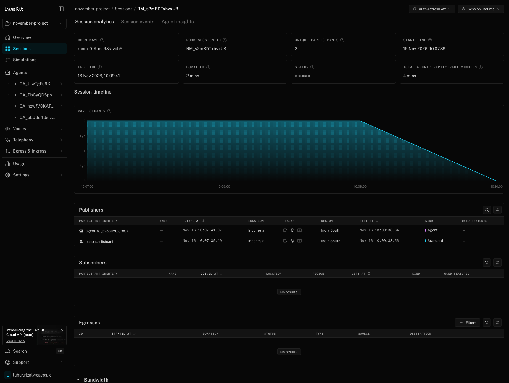

# Two-participant cloud native checkpoint

Successful cloud-dispatch smoke test on 16 November 2026, using the opt-in
single native input/output connection documented in [NATIVE_ROOM.md](NATIVE_ROOM.md).
The default Pion transport remains unchanged; no custom receive/playout policy
was introduced. This checkpoint includes the previously tested integration.

Room: `RM_s2mBDTxbvxUB` (`room-0-Khce98sJvuh5`).
Job: `AJ_pv8ou5QQRnJA`. Agent: `agent-starter-go`.
Cloud server reported 1.13.11, India South. Native setup remains pinned to
FFI0.12.80 / rust-sdks `5a656c4bc4bc5c4f7fad17ab69044db3b487dfeb`.
The cloud artifacts do not independently attest the executable or native-library
hash; those version pins describe the tested setup, not a binary provenance proof.

## Evidence and outcome

The user-supplied LiveKit dashboard screenshot matches this room and shows
**2 unique participants**: `agent-AJ_pv8ou5QQRnJA` (Agent) and
`echo-participant` (Standard). Both appear as publishers. There is no separate
native-receive participant. The dashboard reports a closed two-minute session
and four WebRTC participant-minutes. This closes the participant-count evidence
gap in the initial log-only review.

| Observation | Result |
|---|---|
| Native primary enabled | 10:07:41.573 +0700, assigned agent identity |
| Job termination received | 10:09:38.676 +0700 |
| Enabled-to-termination wall window | 117.103s |
| PCM at helper-to-agent callback | 117.050s; 53ms below the wall window |
| Native helper/queue errors | None reported |
| Source ended | INFO, `track_unsubscribed`, 10:09:39.694 |
| Native primary stopped | 10:09:40.682 |
| Job termination handled | 10:09:45.725; 7.049s after termination request |
| Conversation history | 14 user and 9 assistant messages |
| Reported response latency | 8 measurements; median1.878s, range1.803–2.065s |

The aggregate PCM duration tracks the active wall window closely and does not
show the original large accumulated deficit. The end window includes terminal
lifecycle timing: it is not an exact first/last PCM timestamp comparison.
Per-frame cadence, maximum gaps, packet loss/DTX, duplicated content and acoustic
latency cannot be established from these cloud artifacts. Response latency uses
application speech-stop/output-start timestamps, not remote acoustic playout.
The screenshot independently verifies participant count; it does not establish
packet timing or resource cleanup.

Shutdown traces show session_close3.536s and session_end_upload3.332s within
job_shutdown6.874s. Total termination handling is not helper cleanup duration.
The stopped log follows the adapter's child wait/reap path, but there is no
independent post-run process/resource census in this cloud evidence.

Three LLM `context canceled` warnings occur about400–450ms after renewed user
speech; processing continues. This is consistent with interrupted reply
cancellation, not evidence of native receive failure. The report classifies them
as nonrecoverable LLM errors: retain for separate cancellation-classification
follow-up. STT usage101.9s is a different metric from received PCM117.05s and
must not be interpreted as missing audio without further investigation.

## Preservation and validation

Original inputs were copied byte-for-byte to the new ignored local directory
`../native-receive-probe/results/cloud-primary-RM_s2mBDTxbvxUB/`:
`observability.zip`, `session_report.json`, `session.log`, `participants.png`.
[evidence.json](evidence/cloud-primary-RM_s2mBDTxbvxUB/evidence.json) records
SHA256 hashes and sizes. The screenshot and manifest are committed here; raw
conversation/observability inputs remain in the local results archive. Existing
session files and Downloads inputs were not changed. All3029 prior result-file
hashes were checked unchanged before checkpointing.

The earlier provider-free two-minute native test, shutdown cases, default and
receive-only regression evidence remain under `results/primary-starter-20261115/`.
See NATIVE_ROOM.md for their gates and limits. This checkpoint does not rerun
paid cloud providers or claim repeated-session stability for the primary path.

Known separate repository gate issue remains documented: parity-gate.sh invokes
check-test-integrity.sh without its required arguments. Focused parity and
explicit integrity/analyzer checks passed during integration. Full parity-suite
success is not claimed, and hooks are not bypassed for this checkpoint.

Next validation: repeated primary-native sessions with periodic PCM continuity,
helper-exit/resource diagnostics, and participant counts. No receive-policy
changes are indicated by this successful cloud smoke test.
